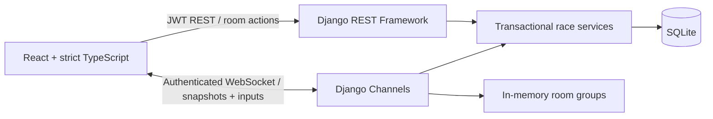

# Pulse — Multiplayer Rhythm Arena

A playable adaptation of Project 6 (Competitive Typeracer). Instead of typing characters, players hit **D / F / J / K** in time with a shared note chart. Django owns timing, scoring, room state, and historical results; React + strict TypeScript renders the game and competitors.

All project code lives here in `Projects/Midterm`. The pre-existing empty `Rhythm` file is untouched. The Wordle and Bunny Run projects are unchanged.

## Quick start

Prerequisites: **Python 3.12**, **Node.js 24**, and npm. SQLite is included with Python; no database service, Redis, API key, or music download is needed for local play.

From `Projects/Midterm`:

```bash
./scripts/setup.sh
./scripts/dev.sh
```

Open the Vite server on port **5173** in your local development browser. API and WebSocket requests are proxied to Django on **8001**. Stop the development script with Ctrl+C. Setup can be rerun; migrations do not erase existing accounts or scores. Both seeded tracks are installed by migrations.

Alternatively, use two terminals:

```bash
# Terminal 1, from Projects/Midterm/backend
.venv/bin/daphne -b 127.0.0.1 -p 8001 config.asgi:application
```

```bash
# Terminal 2, from Projects/Midterm/frontend
npm run dev -- --port 5173 --strictPort
```

### Play with a friend

1. Create an account. Password validation requires a strong password of at least eight characters.
2. Select **Afterglow** (100 BPM) or **Neon Circuit** (140 BPM). Each has 32 notes and a maximum score of 32,000.
3. Create a room and share the eight-character code. A friend signs in with a **different account** and joins. For a local demo, use separate browser profiles or an incognito window. Solo practice also works.
4. Each player clicks **Ready up**. Click **Enable audio** to hear the generated synth notes. The host starts when everyone is ready.
5. After the shared three-second countdown, press **D / F / J / K** when the matching note reaches the horizontal line. Hold-to-repeat does not count. A hardware keyboard is required.
6. Watch scores and animated opponent avatars update. At the end, inspect **Your records** for personal history and the global leaderboard.
7. After a reload, use **Return to a room** to resume. Missed notes stay missed. A disconnected player does not pause the race. Click **Race again** to create a fresh room.

The audio is synthesized in the browser, with no third-party tracks or copyright-dependent assets. Audio and gameplay work without external CDN requests.

## The 15 changes / features

See [FEATURES.md](FEATURES.md) for the numbered list, rubric mapping, implementation files, and demonstration steps. These are 15 implemented features adapting the assignment concept; they are not a fabricated sequence of Git commits. Confirm with your instructor whether a new adaptation satisfies their definition of “15 changes.”

## Architecture



- `backend/arena/models.py`: `Profile` → User (One-to-One); Room → host/song (Foreign Keys); Room ↔ Users (Many-to-Many through Participation); Participation → Hits (Foreign Key). Unique constraints protect membership and scored notes.
- `backend/arena/services.py`: transactional room joins, ready/start transitions, input judgement, and idempotent finalization. `select_related` / `prefetch_related` load participant and song relationships without per-row lookups.
- `backend/arena/views.py` / `serializers.py`: DRF router, serializer validation, authenticated endpoints, host-only starts, capacity checks, aggregated top-20 leaderboard, last-20 personal runs.
- `backend/arena/consumers.py`: authenticate the first socket message using a JWT access token, verify room membership, enforce token expiry, reject malformed inputs, broadcast scores, and periodically send authoritative snapshots. Tokens are never placed in socket URLs.
- `frontend/src/api.ts`: Fetch client, response schema validation, structured errors, one shared refresh-token request when access expires.
- `frontend/src/auth.tsx`: authentication Context. Tokens live in tab-scoped sessionStorage; sign-out clears them. Avoid injecting untrusted HTML; a production application should additionally enforce a Content Security Policy and evaluate an HttpOnly-cookie session design.
- `frontend/src/useRace.ts`: socket lifecycle, capped exponential reconnection delay, clock offset calibration using ping round trip, judgement feedback, and restoration of already-scored notes.
- `frontend/src/Arena.tsx`: keyboard handling, canvas note rendering, Web Audio scheduling. Animation frames use refs instead of React state updates each frame.
- `frontend/src/Standings.tsx`: presentational scores and animated avatar tracks.
- `frontend/src/App.tsx`: page container and orchestration; gameplay, networking, auth, validation, and presentation are split into dedicated modules. All props/state/network payloads are typed; no explicit `any` types.

### Scoring and synchronization

All players receive the same server `starts_at` timestamp and chart. Notes descend with a 1.6-second look-ahead. Web Audio schedules tones shortly ahead of their target time. Browser clocks are calibrated to the server; the server uses **its own receive time** to judge each note. Clients submit only a note index and lane, never a score or trusted timestamp.

| Judgement | Server timing error | Points |
| --- | --- | --- |
| Perfect | ≤ 80 ms | 1,000 |
| Good | > 80 ms and ≤ 180 ms | 600 |
| Miss | No accepted hit in the window | 0 |

Accuracy is weighted points divided by the entire chart maximum, including misses. Consecutive accepted chart notes build a combo; skipping a note breaks it on the next hit. Maximum combo persists. Incorrect keys do not score or consume another lane's note. Duplicate, reordered, out-of-range, and wrong-lane packets are rejected. Final scores and history persist in SQLite.

This is a classroom implementation, **not bot-proof competitive anti-cheat**. Server receive-time judgement favors lower latency; there is no client-controlled latency compensation. Use a local network for demonstrations. If all clients disconnect, a later room, leaderboard, or history read finalizes overdue races. Finalization is lazy, not a background scheduler.

## API and socket contract

All routes except registration and token issuance require JWT authentication.

| Method | Route | Purpose |
| --- | --- | --- |
| POST | `/api/register/` | `{username, password}` → account + profile |
| POST | `/api/token/` | Login → access + refresh |
| POST | `/api/token/refresh/` | Refresh access token |
| GET | `/api/me/` | Current user |
| GET | `/api/songs/` | Paginated chart catalog |
| GET / POST | `/api/rooms/` | List own rooms / create with `{song_id}` |
| GET | `/api/rooms/{code}/` | Member-only room state |
| POST | `/api/rooms/{code}/join/` | Join by code (max four players) |
| POST | `/api/rooms/{code}/ready/` | `{ready: boolean}` in lobby |
| POST | `/api/rooms/{code}/start/` | Host-only synchronized start |
| GET | `/api/leaderboard/` | Each player's best completed score |
| GET | `/api/history/` | Current user's recent completed runs |

Connect to `/ws/rooms/{code}/` through the same frontend origin. Send `{"type":"auth","token":"<access token>"}` within five seconds. After authentication, send `{"type":"hit","note":0,"lane":0}` or `{"type":"ping"}`. The server sends `snapshot`, `judgement`, `pong`, and `error` packets. The Zod definitions in `frontend/src/types.ts` are the client contract. Allowed origins and membership are checked independently. Input frames are bounded to 4 KB and scored inputs are limited to 40 per second per socket; REST uses DRF throttling.

## Validation

```bash
# From Projects/Midterm/backend
.venv/bin/python manage.py check
.venv/bin/python manage.py makemigrations --check --dry-run
.venv/bin/python manage.py test arena

# From Projects/Midterm/frontend
npm run build
npm run typecheck
npm run format:check
```

The backend suite covers password validation, JWT login/refresh, membership, host permissions, ready gating, room capacity, chart validation, timing/lane/type checks, duplicate prevention, combo reset, finalization, leaderboard aggregation, socket authentication, origin restrictions, and reconnect state.

For the two-player browser integration test, start both servers, then:

```bash
# From Projects/Midterm/frontend
npx playwright install chromium
npm run test:e2e
# Or use an existing system Chromium:
CHROMIUM_PATH=/usr/bin/chromium npm run test:e2e
```

The browser test uses two isolated accounts, starts a real race, plays a note in both browsers, asserts remote score broadcasts, reloads a player, waits for completion, and checks persisted history and leaderboard entries. It creates uniquely named test accounts and results in the development database. Do not point it at production data.

Optional Python formatting:

```bash
# From Projects/Midterm/backend
.venv/bin/pip install -r requirements-dev.txt
.venv/bin/black --check arena config manage.py
```

Some managed command sandboxes prevent asyncio socket setup or local servers. Run the socket/browser checks with the environment's permitted network execution capability if they time out before connecting. Do not disable assertions or treat those timeouts as passed tests.

## Configuration and deployment limits

`backend/.env.example` documents the environment variables. The application reads exported environment variables; it does **not** automatically load `.env`. Keep real `.env` files and keys untracked. The frontend uses relative `/api` and `/ws` routes, so it needs no client secret or environment file.

The default is deliberately **one Daphne process**, an **in-memory channel layer**, and **SQLite**. This supports a classroom/local multiplayer demo. Do not run multiple workers: room broadcasts would be isolated. For deployment, use PostgreSQL for row locking, a Redis-backed Channels layer for shared broadcasts, TLS/WSS, a proper reverse proxy routing `/api` and `/ws`, a random `DJANGO_SECRET_KEY`, `DJANGO_DEBUG=0`, explicit `DJANGO_ALLOWED_HOSTS` and `CORS_ALLOWED_ORIGINS`, and a static host for `frontend/dist`. Redis and production hosting are not configured here. No public deployment is claimed.

For two computers on a trusted LAN, bind Vite to the LAN interface (`npm run dev -- --host 0.0.0.0 --port 5173 --strictPort`) and add that exact frontend origin to the exported `CORS_ALLOWED_ORIGINS` before starting Django. Django can remain bound to loopback because Vite proxies it. Do not expose the development server to the public Internet.

## Git workflow

No commits were created automatically. Review the new files, make meaningful commits as you understand and extend each feature, and preserve an honest history. `FEATURES.md` supplies a demonstration checklist; commit it with the implementation rather than presenting fabricated past progress. Dependencies, database files, build output, virtual environments, and test reports are ignored; lockfiles and migrations are included.
